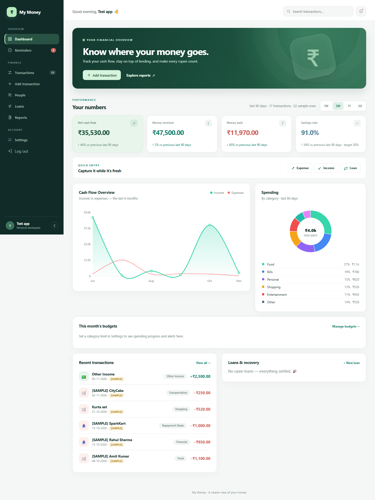
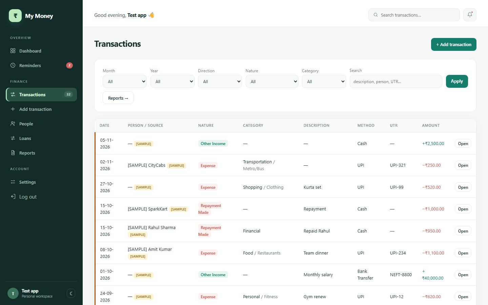

# My Money — personal UPI & transaction manager (web app)

<p>
  
  
  
</p>

A clean finance dashboard for tracking your manual cash / UPI /
banking transactions — with people, loans & repayments, budgets, receipts,
reminders, audit history and CSV/Excel/PDF reports, all in **₹ with Indian
grouping**. No bank connectivity, no payment initiation: the data is yours,
entered by you.

## Screenshots

**Dashboard**



**Transactions**



## Run locally

```bash
pip install -r requirements.txt
python app.py init-user   # create your private login once
python app.py          # → http://127.0.0.1:5000
```

Open the URL and sign in. The login screen is titled **“Test app”**.
Registration and public starter credentials are disabled. The setup command
prompts for a username and password and creates the only account. You can
change both later in Settings. Screenshots use fictional example data; new
installations start empty.

## Features

| Area | Behaviour |
| --- | --- |
| Money | Stored as **integer paise**, displayed ₹ 1,23,456.78 (Indian grouping) |
| Clock | Fixed **Asia/Kolkata (UTC+5:30)**; dates DD-MM-YYYY |
| Natures | expense · refund · other income · loan given/taken · repayment received/made · gifts · self transfer (10 natures) |
| Loans | Balance = principal − Σ **explicitly linked** repayments (never auto-assumed). Status: Open / Partially Repaid / Overdue / Settled |
| Repayments | Must choose the loan; date, method, UTR, notes; can never exceed balance |
| Budgets | Monthly limit per category; dashboard progress + reminders alert at 80% and at the limit |
| Duplicates | Warns on reused UTR and same person+date+amount; save needs the explicit “save anyway” tick |
| Audit | Every edit/cancel/attachment is stored with old→new values; cancel keeps history |
| Receipts | Attach images/PDF ≤ 6 MB per transaction, served back only to their owner |
| Reminders | Overdue loans, due in 7 days, missing descriptions, duplicate UTRs — computed on the fly |
| Reports | CSV, Excel (openpyxl) and PDF (reportlab, ₹ glyph via embedded Unicode font) with the same filters |
| UI | Light/dark theme (persisted per browser), responsive, vanilla-SVG charts — **zero third-party JS** |
| Security | pbkdf2 password hashing (600k iterations), session CSRF on every POST, per-account data isolation |

## Host your own instance

Any Python 3.10+ host works. Two common options:

```bash
# production: gunicorn
pip install gunicorn
gunicorn -w 2 -b 0.0.0.0:8000 "mymoney:create_app()"
```

Environment variables:

| Var | Purpose |
| --- | --- |
| `MYMONEY_SECRET` | Pinned Flask session secret (required when running multiple workers) |
| `MYMONEY_DB` | Alternate SQLite file (defaults to `instance/mymoney.db`) |

Run `python app.py init-user` once before starting the production server.
Set `MYMONEY_SECRET` to a private random value and serve the app behind HTTPS.
`instance/` holds your SQLite DB and uploaded receipts — back it up; it is
git-ignored by design so secrets never reach a repository. GitHub hosts this
source code; GitHub Pages cannot run a Flask server.

## Project layout

```
MyMoney/
├─ app.py                  entry point
├─ run_server.py           detached launcher (dev)
├─ requirements.txt
├─ LICENSE                 MIT
├─ docs/                   UI screenshots for this README
├─ instance/               mymoney.db + secret_key + uploads/ (auto-created, git-ignored)
├─ mymoney/
│  ├─ __init__.py          create_app, security defaults
│  ├─ db.py                sqlite schema + helpers
│  ├─ auth.py              login, pbkdf2 (600k iters), sessions, CSRF
│  ├─ utils.py             IST clock, paise math, ₹ formatting
│  ├─ service.py           balances, loan status, dedupe, audit, reminders
│  ├─ transactions.py      add/edit/cancel, attachments
│  ├─ people.py            people + per-person history
│  ├─ loans.py             loans, repayment log, reminders page
│  ├─ dashboard.py         KPIs, budgets, /api/summary.json for charts
│  ├─ reports.py           CSV / XLSX / PDF / print view
│  ├─ settings.py          preferences, budgets, account controls
│  └─ sample_data.py       fictional data fixture for development
├─ templates/              Jinja pages (auth, dashboard, txn, people, loans…)
└─ static/                 style.css (CSS variables), app.js (charts, theme)
```

## Contributing

PRs are welcome — keep the dependency set tiny (Flask + openpyxl +
reportlab) and the UI framework-free.

## License

[MIT](LICENSE) — do what you like, attribution appreciated.
No bank integration, no payment initiation: this project intentionally never
touches your bank credentials or initiates UPI requests.
